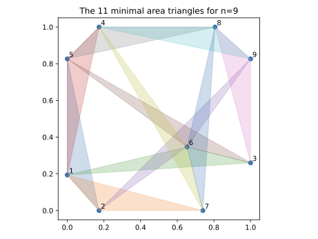

# Heilbronn's Triangle Problem

Code and data for the paper

> N. Sudermann-Merx, *From Global Optimization to Exact Coordinates: Heilbronn's Triangle Problem on the Unit Square Using Mixed-Integer Nonlinear Optimization*, 2026.

The version of this repository that accompanies the first submission is tagged
[`mpc-submission`](../../tree/mpc-submission).

## Status of the configurations

| n | Status |
|---|---|
| 3 ≤ n ≤ 8 | proven optimal (literature, see the paper) |
| 9 | optimal within solver tolerances: the exact value is a rigorous lower bound that matches Gurobi's numerical upper bound, but no rigorous proof is known |
| 10 | optimal within solver tolerances (new in the revision): the configuration of Comellas and Yebra (2002) is exactly verified, and Gurobi's numerical upper bound lies 1.2e-4 relative above its value. The bound also uses the numerical bound for n = 9 |
| 11 ≤ n ≤ 16 | best known. The n = 15 configuration (Sudermann-Merx 2026, heuristic search) replaced Karpov (2011) |

<p align="center">
  
</p>

## Contents

- **app.py** — Interactive visualizer for Heilbronn configurations (drag points to explore)
- **experiments/** — The MINLP models and the computational study of the paper (run plan, driver, tables)
- **optimization_models/** — The Gurobi formulations of the first submission (kept for reference)
- **best-known-configurations/** — Point configurations for n = 3, …, 16 as JSON (full-precision doubles, status, source, exact value or minimal polynomial)
- **exact_coordinates/** — Exact symbolic coordinates for n = 5, …, 10 (SymPy) and the Gurobi solutions they start from
- **verification/** — Exact checks: all triangle areas for n = 5, …, 10 (`verify_exact.py`), copies of an optimum feasible for the final model (`count_copies.py`, `check_symmetric_feasible.py`), critical and distinct areas (`distinct_areas.py`), LICQ by exact rank (`licq_check.py`)
- **figures/** — Configuration plots

## Interactive App

The interactive visualization app was conceived by Hendrik Ewe, who also provided the first version.

`app.py` is a Tkinter application that lets you explore the Heilbronn configurations interactively:

- Switch between best-known configurations for n = 3, …, 16
- Drag points with the mouse and see the smallest triangles update in real time
- Critical triangles are colored using the matplotlib tab10 palette (matching the paper figures) with true alpha transparency

```bash
pip install Pillow   # only additional dependency
python app.py
```

## Requirements

- Python 3.12 (gurobipy 11.0.1 does not support later versions)
- [Pillow](https://python-pillow.org/) (for the interactive app)
- [Gurobi](https://www.gurobi.com/) 13.0.3, optionally 11.0.1 (for the MINLP models, see `experiments/requirements.txt`)
- [SymPy](https://www.sympy.org/) 1.14 and mpmath (for the exact coordinates and the verification)

## Usage

```bash
python exact_coordinates/exact_coordinates.py 7
cd verification && python verify_exact.py
cd experiments && ./run.sh --smoke
```

## Citation

```bibtex
@article{SudermannMerx2026Heilbronn,
  author  = {Sudermann-Merx, Nathan},
  title   = {From Global Optimization to Exact Coordinates:
             {Heilbronn}'s Triangle Problem on the Unit Square
             Using Mixed-Integer Nonlinear Optimization},
  year    = {2026},
}
```

## License

MIT
